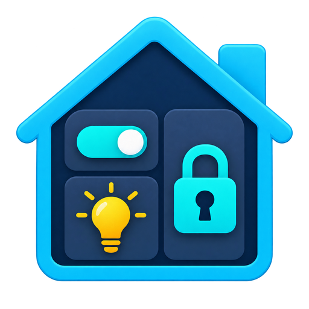

<p align="center">
  
</p>

# Limited Access Dashboard for Home Assistant

Give someone the controls they need without giving them access to your full
Home Assistant system.

Limited Access Dashboard creates a separate, mobile-friendly page for a child,
contractor, cleaner, sitter, landscaper, Airbnb/Vrbo guest, or visitor. You
choose what appears and when it can be used. The person using it cannot edit the
dashboard, browse your devices, or open your Home Assistant settings.

## What it does

- Uses a separate username and password—not a Home Assistant account.
- Is set up visually in Home Assistant; no YAML is required.
- Supports a separate dashboard for each person or purpose.
- Shows only the controls you choose.
- Uses familiar Home Assistant-style cards on phones and computers.
- Works remotely through your Home Assistant Cloud address.
- Can restrict access to certain dates and hours.
- Automatically stops each sprinkler test after a set time.
- Provides a **Stop all water** button.
- Records sign-ins and commands for the homeowner.

The guest cannot see Home Assistant dashboards, history, settings, searches,
automations, or other devices.

## Example uses

- Let a landscaper test sprinkler zones for five minutes at a time.
- Give a cleaner access to selected lights during a weekly visit.
- Give a child a simple dashboard containing approved household controls.
- Give a rental guest a dashboard that expires at checkout.
- Give a visitor temporary access that can be removed immediately.

You can add lights, switches, media players, buttons, scenes, scripts, input booleans, sensors,
binary sensors, and climate entities. Sensors and climate entities are shown as
read-only information. Media players show the power, playback, track, volume,
and mute controls supported by the device. Media browsing and arbitrary media URLs
are not exposed. Selected Rachio zone switches automatically use timed watering;
sprinkler settings stay hidden for everyone else.

## Install with HACS

Until this project is listed in the main HACS catalog, add it as a custom
repository:

1. Open **HACS** in Home Assistant.
2. Select **Integrations**.
3. Open the three-dot menu and choose **Custom repositories**.
4. Add `https://github.com/EndOfTheLine-HA/ha-limited-access-dashboard`.
5. Choose **Integration** as the type.
6. Find **Limited Access Dashboard** and select **Download**.
7. Restart Home Assistant.

## Create a limited dashboard

1. Open **Settings → Devices & services**.
2. Select **Add integration**.
3. Search for **Limited Access Dashboard**.
4. Choose the dashboard name and its short web-address name.
5. Create a separate username and password for the guest.
6. Choose an entity type to filter the list, then add the entities you want.
   To add more types, turn on **Add another entity type before continuing**.
   Your selected entities stay selected and can be removed or reordered.
7. Choose an expiration date or an allowed weekly schedule if needed.
8. Copy the dashboard link on the final screen, then save.

To create another dashboard, add the integration again. To change an existing
one, select **Configure** on its integration card.

Passwords must contain at least 8 characters. They are stored as secure
Argon2 hashes and are never shown again. Leaving the password box blank while
editing keeps the existing password.

## Open and share the dashboard

Setup shows the dashboard link and guest username before saving. Send the link
and the separate dashboard password to your guest. They open it in a browser;
they do not need the HA app or a Home Assistant account.

To find the link later, open the integration's dashboard device and select
**Visit**, or open **Configure** on the integration entry. The link uses your
configured remote address (including Home Assistant Cloud) when available.
If it shows a local address, it only works on your home network; configure remote
access before sharing it with someone away from home.

Local address:

```text
http://homeassistant.local:8123/limited-access-dashboard/your-web-address-name
```

For remote access, add the same path to your Home Assistant Cloud address:

```text
https://your-address.ui.nabu.casa/limited-access-dashboard/your-web-address-name
```

If you have only one limited dashboard, the shorter
`/limited-access-dashboard` address redirects to it automatically. Share the
address and the separate dashboard credentials with the person who needs
access. Do not share your Home Assistant account.

The page does not expose a Home Assistant access token. Every displayed entity
and every allowed action is checked on the server against the choices made by
the administrator.

The plugs filter shows switches classified as outlets in HA. If a plug is not
listed there, look under **Switches**. Timed irrigation currently supports Rachio
zone switches only, not controller, rain-delay, hose-timer, or schedule switches.

## Safety

This is a community project. Test it with non-critical devices first.

Do not use it for locks, gates, garage doors, alarms, heaters, or other
safety-critical controls. Keep automatic shutoff and other physical safety
rules inside Home Assistant itself.

See [SECURITY.md](SECURITY.md) before exposing a dashboard outside your home.

## What is planned

- More card layouts and entity types.
- Carefully sandboxed support for selected Lovelace and HACS cards. Arbitrary
  custom cards are not loaded today because they normally expect a full Home
  Assistant login and API access.
- Reusable access profiles.
- Single-use invitation links.
- Optional Airbnb/Vrbo calendar dates.
- Home Assistant notifications for sign-ins and commands.

## Advanced and developer information

The repository also contains an earlier standalone Docker version for advanced
users and contributors. See [Advanced setup and development](docs/ADVANCED.md).

## License

MIT

This community project is not affiliated with or endorsed by the Home Assistant
project, Nabu Casa, Airbnb, or Vrbo.

